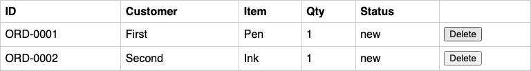

# BUG-005: Order table is not refreshed after a delete

| Field | Value |
|---|---|
| Severity | Medium |
| Why | The server deletes the order but the page keeps showing it, so users may think the delete failed and click again. A reload fixes it. |
| Component | Orders page (UI) |
| Environment | `BUGGY_MODE=BUG-005` (also on with `BUGGY_MODE=1`), local uvicorn, Chromium headless via Playwright, Python 3.13 |
| Requirement | REQ-012 (deleting an order removes its row without a page reload) |

## Steps to reproduce
1. Start the app with `BUGGY_MODE=BUG-005 make run` and create two orders (for example through the form).
2. Open `http://localhost:8000/` and click Delete on the row for ORD-0001.
3. Look at the table without reloading, then reload the page.

To run the reproduction script from the repo root (it starts the app itself): `.venv/bin/python docs/bug_reports/repro/BUG-005.py`

## Expected
The ORD-0001 row disappears as soon as the server confirms the delete.

## Actual
The server answers 204, but the row stays in the table. After a manual reload it is gone.

Does not reproduce with BUGGY_MODE unset: test_bug005_delete_removes_row_without_page_reload passes in results/correct_run.txt.

## Evidence
Output of a scripted run of these steps with Playwright (the script sets `ENABLE_TEST_ENDPOINTS=1` itself, only to reset state before it starts) (`results/evidence/BUG-005_repro.txt`):

```
step 1: page opened, data-buggy = 1
step 2: rows before delete (ORD-0001 visible): True
step 3: clicked Delete, server answered HTTP 204
step 4: ORD-0001 rows still in table, no reload: 1
step 5: ORD-0001 rows after manual reload: 0
```

Screenshot of the table at step 4, after the delete and before the reload (same run as the output above). ORD-0001 is still listed:



Dedicated test, run with `BUGGY_MODE=BUG-005` (`results/evidence/BUG-005_test.txt`):

```
tests/ui/test_orders_ui.py::test_bug005_delete_removes_row_without_page_reload
E   AssertionError: Locator expected to have count '0'
E   Actual value: 1
E     - Expect "to_have_count" get_by_test_id("order-row-ORD-0001") with timeout 2000ms
```

Two tests fail with only this bug on (`results/by_bug/BUG-005.txt`): the dedicated test, and `test_create_two_orders_delete_one_keeps_the_other`, which also fails with BUG-003 alone.
